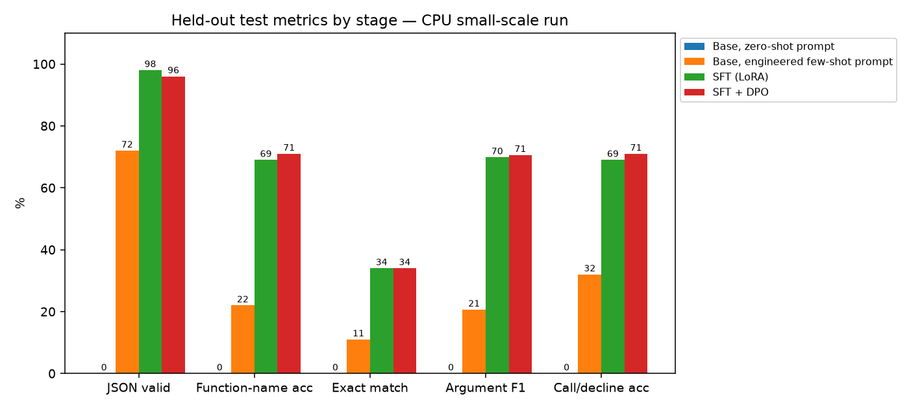
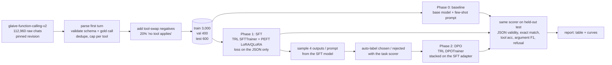
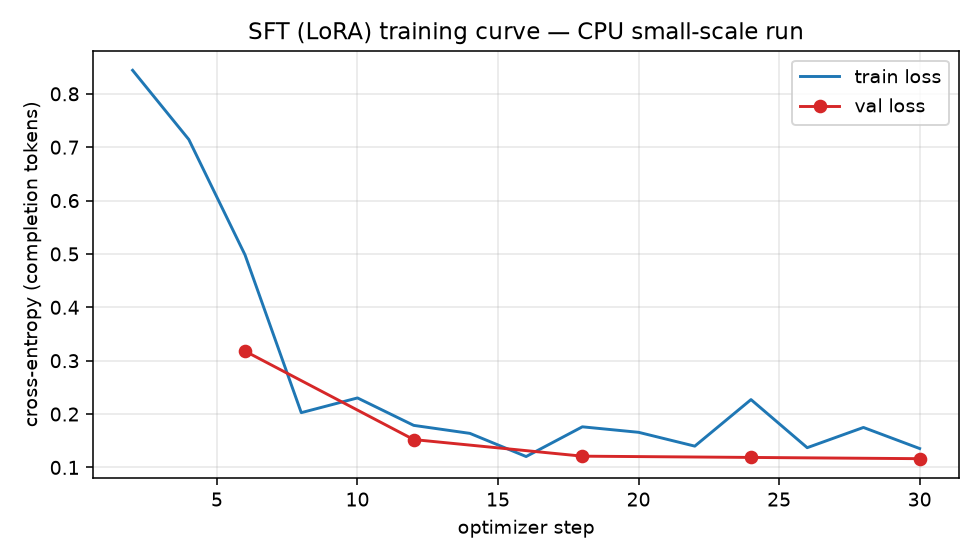
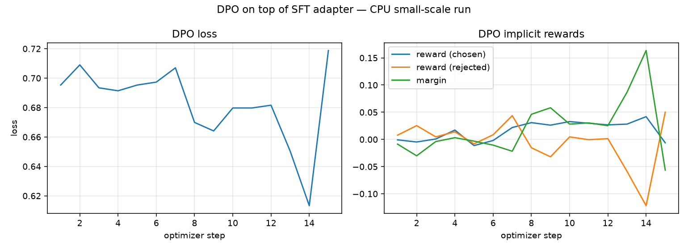

# Fine-tuning for tool-call accuracy: prompt baseline → LoRA SFT → DPO

<!-- links -->
[](https://github.com/burlarakesh1458-sys/toolcall-finetune-sft-dpo/actions/workflows/ci.yml) **Live demo:** <http://rakeshburla.dpdns.org/toolcall-finetune-sft-dpo/> · **Code:** <https://github.com/burlarakesh1458-sys/toolcall-finetune-sft-dpo> · **Resume bullets:** [RESUME_BULLETS.md](RESUME_BULLETS.md) · **License:** MIT

> Teach a language model to pick the right function **and** fill its arguments correctly — or decline when no
> tool fits — and prove the gain over the best prompt with numbers on a held-out test set.



**Headline (measured, CPU small-scale run: SmolLM2-135M-Instruct, 240 training examples, 100 held-out test
examples):** LoRA SFT beat the best engineered prompt on every call metric — exact match 11% → 34%, JSON validity
72% → 98%, argument F1 20.6% → 69.8%. DPO stacked on top gave **no further exact-match gain** (34% → 34%); it
removed the remaining false declines but did not fix the SFT model's 0% decline recall. Section 6 has the full
table and section 7 explains why.

**Status, stated plainly**

| What | Where | Executed? |
|---|---|---|
| Full pipeline (data → baseline → SFT → DPO → eval → report) at small scale | `configs/cpu_small.yaml`, SmolLM2-135M-Instruct, 2-core CPU | **Yes — every number below is measured from this run** |
| Strong-model reference (gpt-oss-120b via Groq, same prompt, same test examples) | `src/toolcall_ft/groq_reference.py` | **Yes** |
| Qwen3-8B + QLoRA on an A100 / T4 | `configs/gpu_qwen3_8b.yaml`, `configs/colab_t4_qwen3_8b.yaml` | Ready to run on GPU, **not executed here** |
| Axolotl equivalents | `configs/axolotl/*.yaml` | Ready to run on GPU, **not executed here** |
| One-click Colab notebook | `notebooks/train_colab.ipynb` | Ready for a free T4, **not executed here** |

---

## 1. Problem

Agents fail in boring ways: they call the wrong function, invent an argument, send `"5"` where the schema wants
`5`, or call *something* when they should say "I can't do that". This project targets exactly that single step:

```text
input : tool schemas (JSON) + a user request
output: {"tool": "<name>", "arguments": {...}}     # a tool applies
        {"tool": null, "arguments": {}}           # no tool applies -> decline
```

## 2. Why fine-tune instead of prompting?

Fine-tuning does not make a model generally smarter; it makes it *consistently* good at one well-defined
contract. The test for whether it is worth it is simple: build the best prompt you can, measure it, then measure
the fine-tuned model on the same held-out set. If the gap is not there, don't fine-tune.

Here the baseline is a carefully engineered prompt: strict output contract, type rules, an explicit decline
format, and three hand-written demonstrations (a call, a two-tool selection, a decline) that are **not** drawn from
the dataset, so they cannot leak test answers. A zero-shot version of the same prompt is reported too.

## 3. Pipeline



## 4. Dataset card (short version — full card in [`data/DATA_CARD.md`](data/DATA_CARD.md))

- **Source:** [`glaiveai/glaive-function-calling-v2`](https://huggingface.co/datasets/glaiveai/glaive-function-calling-v2)
  @ `e7f4b64`, Apache-2.0. (`Salesforce/xlam-function-calling-60k` was the first choice but is gated.)
- **Cleaning:** 112,960 raw records → drop no-tool prompts (34,598), duplicates (44,314), clarifying-question
  turns (25,520), unparseable calls (1,663), invalid gold calls / schemas (≈450) → 6,217 unique calls + 217 natural
  declines → cap 40 per tool → **4,000 examples** (3,200 calls, 217 natural declines, 583 synthetic tool-swap
  negatives).
- **Splits:** 3,000 / 400 / 600, stratified, 20% declines in each, no query shared across splits (asserted).
- **Gold-label validation:** the called tool must exist, required args present, no unknown args, JSON types and
  enums respected — 39 gold calls failed this and were dropped.

## 5. Metrics

All computed by one scorer (`src/toolcall_ft/scorer.py`, unit-tested):

| Metric | Definition |
|---|---|
| JSON valid | output is exactly one JSON object `{"tool", "arguments"}` (code fences tolerated, prose is not) |
| Exact match | right tool **and** the full argument dict (case/whitespace-insensitive strings, 5 == 5.0) |
| Function-name acc | right tool name (`null` == `null` counts) |
| Argument F1 | micro-F1 over (key, value) pairs on examples whose gold is a call |
| Call/decline acc ("refusal correctness") | the call-vs-decline decision is right; invalid output counts as wrong |
| Decline recall / False-decline rate | declines on gold-decline examples / declines on gold-call examples |

## 6. Results — CPU small-scale run (measured)

**Setup actually executed:** SmolLM2-135M-Instruct, LoRA r=16 on all attention + MLP projections
(4.88M trainable parameters, 3.5% of 139M), 240 training examples (1 epoch, effective batch 8, 30 optimizer
steps), 24 validation examples, evaluated with greedy decoding on the **first 100 examples of the held-out test
split** (74 gold calls, 26 gold declines). Every stage — and the gpt-oss-120b reference — is scored on exactly those
100 ids by the same scorer. This is a small-scale CPU run that proves the pipeline end to end; it is not the
Qwen3-8B result the GPU configs are built for.

| Stage | n | JSON valid | Function-name acc | Exact match | Argument F1 | Call/decline acc | Decline recall | False-decline rate |
|---|---:|---:|---:|---:|---:|---:|---:|---:|
| Base, zero-shot prompt | 100 | 0.0% | 0.0% | 0.0% | 0.0% | 0.0% | 0.0% | 0.0% |
| Base, engineered few-shot prompt | 100 | 72.0% | 22.0% | 11.0% | 20.6% | 32.0% | 11.5% | 43.2% |
| **SFT (LoRA)** | 100 | **98.0%** | 69.0% | **34.0%** | 69.8% | 69.0% | 0.0% | 4.1% |
| SFT + DPO | 100 | 96.0% | **71.0%** | **34.0%** | **70.6%** | **71.0%** | 0.0% | **0.0%** |
| Reference: gpt-oss-120b (Groq API), few-shot | 100 | 100.0% | 99.0% | 92.0% | 93.6% | 99.0% | 100.0% | 1.4% |

(`results/cpu_small/results_table.md`, raw numbers in `metrics_*.json`, every prediction in `predictions_*.jsonl`.)

**What the numbers say**

- **SFT is the big win.** Against the best prompt for the same model, LoRA SFT on just 240 examples took JSON
  validity from 72% to 98%, exact match from 11% to 34% (3.1×), function-name accuracy from 22% to 69%, argument F1
  from 20.6% to 69.8%, and cut the false-decline rate from 43.2% to 4.1%. The zero-shot base model produced no
  valid output at all (it echoed the schema or wrapped JSON in prose), which is why the few-shot prompt is the real
  baseline.
- **SFT never learned to decline.** Decline recall is 0/26 even though 47 of the 240 training examples (19.6%)
  are declines: the fine-tuned model always calls *something*. Most of its "Call/decline acc" errors are exactly
  those 26 cases.
- **DPO gave no exact-match gain at this scale — stated plainly.** 79 of 100 predictions are byte-identical to
  SFT. Net changes: false declines 3 → 0, function-name accuracy +2 points, argument F1 +0.8 points, but two
  outputs that were valid JSON became invalid — both repetition loops cut off at the token limit, one of them
  previously an exact match. So JSON validity fell 98% → 96% and exact match stayed at 34%. On 100 examples a 2-point move is two examples, so none of these
  SFT→DPO differences is statistically meaningful.
- **Why DPO moved the needle the way it did.** The scorer-labelled pairs came from 32 fresh training prompts × 4
  samples (temperature 1.0) of the SFT model: 29 pairs, 14 of them gold-anchored (no sample was exact). 16 of the 29
  rejected answers were invalid JSON and 8 were false declines, but only 2 pairs had a decline as the *chosen*
  answer. So the preference data taught "don't decline when a tool fits" (false declines did go to 0) and gave
  almost no signal for "decline when nothing fits" — the SFT model's real weakness. The fix is in the data, not
  the optimizer (see Future work).
- **The gap to a frontier model is still large** (34% vs 92% exact match). Of gpt-oss-120b's 8 misses, 7 are
  dataset label conventions (empty-string fillers, invented defaults, dates frozen in 2022), not model errors —
  see [`results/cpu_small/groq_error_analysis.md`](results/cpu_small/groq_error_analysis.md). Fine-tuning learns
  those conventions; prompting cannot.

**Training curves**



SFT: completion-only cross-entropy fell from 0.844 (step 2) to 0.135 (step 30); validation loss 0.318 → 0.152 →
0.121 → 0.119 → 0.116 at steps 6/12/18/24/30, with validation token accuracy 90.7% → 96.0%. Validation loss kept
falling and never turned up, so one epoch did not overfit. (Steps 21–30 ran after resuming from `checkpoint-20`
when the sandbox rebooted.)



DPO (β = 0.1, LR 5e-5, effective batch 2, 15 steps, 420 s): the loss starts at ln 2 ≈ 0.693 as expected when the
policy equals the reference, and the chosen-vs-rejected margin grows to +0.16 by step 14 (loss 0.613). Step 15 is a
single leftover pair, so its spike is noise. Margins this small mean the policy barely moved from the SFT
reference, which matches the 79/100 identical predictions.

**Compute:** 2 vCPU aarch64, 7.8 GB RAM, no GPU. SFT ≈ 48 min wall-clock in total (steps 1–20 ≈ 21 min, steps
21–30 ≈ 28 min under heavy CPU steal), sampling for DPO pairs 33 min, DPO training 7 min, each 100-example evaluation
≈ 10–18 min.

## 7. What went wrong and how I iterated

Every item below actually happened during this project; the fix is in the code or config.

| # | What went wrong | What I saw | What I changed |
|---|---|---|---|
| 1 | **First-choice dataset was gated** | `Salesforce/xlam-function-calling-60k` returned HTTP 401 from a script | Switched to `glaiveai/glaive-function-calling-v2`, pinned to a commit hash, and wrote a stricter parser/validator because glaive is messier (single-quoted `arguments` strings, clarifying-question turns, invalid gold calls) |
| 2 | **Messy labels** | 25,520 first turns were clarifying questions, 1,663 calls had unparseable arguments, 39 gold calls violated their own schema | Dropped all three classes rather than "fixing" them; per-tool cap of 40 so loan/BMI/password generators don't dominate (see the data card) |
| 3 | **Too few natural declines** (217) for a meaningful refusal metric | Refusal correctness would rest on a handful of examples | Added *tool-swap negatives*: real requests paired with tools from a different example, labelled `{"tool": null}`; 20% declines in every split |
| 4 | **Out of memory on a 7.8 GB shared CPU box** | Qwen2.5-0.5B-Instruct SFT was OOM-killed | Moved the executed run to SmolLM2-135M-Instruct; kept Qwen3-8B QLoRA as the GPU config |
| 5 | **Still OOM-killed during SFT** | Full-vocab (49k) logits for micro-batch 2 × 640 tokens dominated RAM | Micro-batch 1 + gradient accumulation 8 (same effective batch), non-reentrant gradient checkpointing, frozen base held in bf16 during training only |
| 6 | **Kills mid-run lost work** | Each OOM/reboot restarted evaluation and training from zero | Made every stage resumable: eval writes a per-chunk cache, SFT/DPO save LoRA checkpoints and resume from the last one, the pipeline skips stages whose artefact exists, and a supervisor loop re-launches it. SFT in this run really was resumed from `checkpoint-20` after the sandbox rebooted |
| 7 | **Decoding was pathologically slow** | Profiling showed ~80% of forward time inside PyTorch's CPU SDPA kernel on this aarch64 box | `attn_implementation: eager` |
| 8 | **bf16 decoding was *slower* than fp32 on CPU** | Timed both | Evaluate in fp32, train with a bf16 frozen base; generation stops per row as soon as the JSON object closes instead of always running `max_new_tokens`; LoRA merged into the base weights for inference |
| 9 | **Zero-shot looked like 0% across the board** | The base model echoed the schema (`"parameters": {"type": "object", ...}`) or wrapped JSON in prose | That *is* the honest zero-shot number; it is why the engineered few-shot prompt is the real baseline to beat |
| 10 | **Groq free-tier rate limits** on the strong-model reference | A full 600-example run was not practical | Ran it on the same 100 test examples as the local stages, with retry/backoff and a resumable prediction cache |
| 11 | **The strong model "failed" on dataset quirks** | gpt-oss-120b missed 8/100 exact matches | Read all 8: 7 are label conventions (empty-string fillers, invented defaults, the year 2022), not model errors — documented in `results/cpu_small/groq_error_analysis.md` |
| 12 | **CPU time budget for DPO** | After a reboot the shared host ran with ~40–50% CPU steal; SFT steps went from ~50 s to ~2–4 min and evaluating 100 examples took ~25 min | Cut DPO from 64 to 32 prompts (still 4 samples each, scorer-labelled → 29 pairs) and used effective batch 2 so the run still has 15 optimizer steps; the GPU configs use 1,000 (A100) / 300 (T4) prompts |
| 13 | **DPO crashed on start-up**: `KeyError: "attribute 'train' already exists"` | I had named the trainable copy of the SFT adapter `"train"`; PEFT registers adapters as sub-modules, and `train` is already a method on every `nn.Module` | Renamed the adapters `policy` / `reference` (TRL's `model_adapter_name` / `ref_adapter_name`) |
| 14 | **The sandbox rebooted twice** — once mid-SFT, once with the SFT+DPO evaluation at 96/100 | Processes and `/tmp` (including the virtualenv) were wiped | Virtualenv moved to persistent storage with a one-command rebuild script; thanks to item 6 the SFT resumed from step 20 and the evaluation finished only the last 4 examples |
| 15 | **DPO did not improve exact match** | 79/100 predictions identical to SFT; false declines 3 → 0 but 2 outputs became invalid JSON | Diagnosed rather than tuned for the test set: the automatically labelled pairs almost never had a decline as the chosen answer (2 of 29), so DPO had nothing to teach about the SFT model's real failure (0% decline recall). Reported as is; the fix belongs in pair construction (Future work) |

**Lessons I'd keep:** measure the prompt baseline first (the zero-shot 0% would have made any fine-tune look
miraculous); make every long CPU/GPU job resumable from day one; and inspect the preference pairs before training
on them — their composition predicted the DPO outcome better than the loss curve did.

## 8. Reproduce

```bash
# CPU (what was run here)
make install                       # CPU torch wheel + pinned deps
make data                          # downloads the pinned raw file (~271 MB) and rebuilds data/processed
make pipeline CONFIG=configs/cpu_small.yaml
make test lint

# GPU, Qwen3-8B QLoRA (not executed here)
make install-gpu
make pipeline CONFIG=configs/gpu_qwen3_8b.yaml
# optional strong-model reference (needs GROQ_API_KEY)
make groq CONFIG=configs/cpu_small.yaml

# Docker (CPU): same pipeline in a pinned image; results/ and outputs/ are mounted back to the host
docker build -t toolcall-ft .
docker run --rm -v "$PWD/results:/app/results" -v "$PWD/outputs:/app/outputs" toolcall-ft
```

- **CI:** GitHub Actions runs ruff, the 21 offline tests (scorer, data prep, prompt building; no GPU, no API key)
  and builds the CPU Docker image on every push.

- **Colab:** open `notebooks/train_colab.ipynb` on a free T4; it runs the same modules with
  `configs/colab_t4_qwen3_8b.yaml` (or `colab_t4_small.yaml` for a quick run).
- **Axolotl:** `python -m toolcall_ft.export_axolotl` then
  `accelerate launch -m axolotl.cli.train configs/axolotl/sft_qwen3_8b_qlora.yaml` (and the DPO YAML after
  `build_dpo_pairs`).
- **Logging:** TensorBoard by default (`outputs/<run>/tb`), CSV + JSON curves in `results/<run>/`, PNG plots via
  `make report`. Add `wandb` to `report_to` in the YAML for Weights & Biases.
- **Reproducibility:** every stage is config-driven (YAML), seed 42 everywhere (data split, sampling, trainer),
  dataset pinned to a revision, versions pinned in `requirements.txt`. Stages are resumable (eval caches, trainer
  checkpoints), which mattered here — see section 7.

### Repository layout

```text
configs/            cpu_small (executed) · gpu_qwen3_8b · colab_t4_* · axolotl/
data/processed/     train/val/test JSONL + stats.json (committed, ~3 MB)     data/DATA_CARD.md
src/toolcall_ft/    data · prompts · scorer · evaluate · train_sft · build_dpo_pairs · train_dpo · report · groq_reference · export_axolotl
scripts/            run_pipeline.sh (resumable end-to-end runner)
results/cpu_small/  metrics_*.json · predictions_*.jsonl · *_curve.csv · plots/*.png · results_table.md
notebooks/          train_colab.ipynb
tests/              data processing + scorer (pytest)
outputs/            adapters, checkpoints, TensorBoard (git-ignored)
```

## 9. Future work

- **Run the GPU config for real.** `configs/gpu_qwen3_8b.yaml` (Qwen3-8B, 4-bit QLoRA r=16, the full 3,000-example
  train split for 2 epochs, 1,000 DPO prompts, the full 600-example test set) is the version that answers the
  actual question; the CPU run only proves the pipeline end to end. `colab_t4_qwen3_8b.yaml` is the free-T4
  variant. Neither has been executed, so no numbers are claimed for them.
- **Clean the labels before training, not just the outputs.** The Groq error analysis shows exact match on glaive
  partly measures agreement with dataset quirks (empty-string fillers, invented defaults, the year 2022). Next step:
  drop empty-string arguments, drop gold arguments that are not in the request, and re-date relative dates,
  then re-score every stage on the normalised test set alongside the raw one.
- **Better preference data, aimed at the measured failure.** The SFT model never declines (0/26), yet only 2 of
  29 DPO pairs had a decline as the chosen answer. Next run: oversample gold-decline prompts when building pairs,
  add (gold decline ≻ the model's confident call) pairs for every tool-swap negative, and use more prompts and 8+
  samples per prompt. Both outputs that DPO turned invalid are repetition loops (`[5, "cube", 5, "cube", ...]`, a
  run of zeros) cut off at the token limit; adding an SFT term to the DPO loss (TRL's `rpo_alpha`) is the standard
  guard against that drift.
- **Fix the SFT decline gap directly.** Upweight or oversample declines in SFT, or add a short "no tool fits"
  rationale token, and check decline recall on the validation set during training rather than only at the end.
- **Try the alternatives to plain DPO** that TRL already ships: IPO / `loss_type="robust"` for noisy automatic
  labels, KTO (works from single good/bad labels, no pairs needed), and ORPO (SFT + preference in one stage).
- **Constrained decoding as a baseline.** Grammar/JSON-schema-constrained generation (e.g. Outlines or
  llama.cpp grammars) fixes JSON validity without training; the honest comparison is fine-tuned vs.
  constrained prompting vs. both.
- **Multi-turn and parallel calls.** This project scores one decision per example. Real agents need the
  follow-up turn after a tool result, parallel calls, and clarifying questions (dropped here as ambiguous).
- **Confidence intervals.** With 100 test examples a 1-example change is 1 point; bootstrap CIs over the full
  600-example test set (GPU run) would make stage-to-stage differences defensible.
- **Serve it.** Merge the adapter, export to GGUF, and put it behind the same function-calling interface the
  agent project uses, so the latency/quality trade-off vs. a hosted model can be measured.

## License

MIT © 2026 Rakesh Burla. The processed data is derived from glaive-function-calling-v2 (Apache-2.0).
